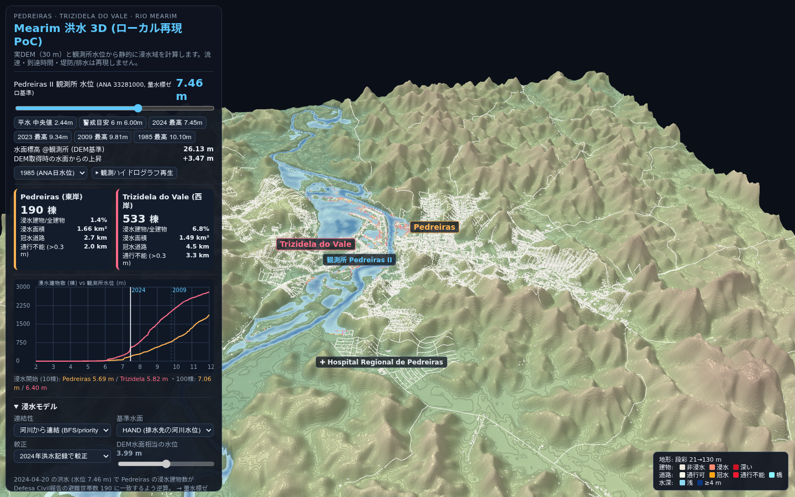

# Mearim 洪水 3D — ローカル再現 PoC

ブラジル・マラニョン州 **Rio Mearim** 沿いの2都市 — **Pedreiras**（東岸）と **Trizidela do Vale**（西岸）— を対象に、
観測所水位から浸水域を計算して3D表示するインタラクティブな Web アプリです。

参考アプリ [sael.net/mearim-flood](https://sael.net/mearim-flood/) の技術調査に基づく**独立実装**であり、
ソースコードやアセットは複製していません（元アプリは再利用に明示的許可が必要と明記）。



## できること

- 実DEM（30 m）の3D地形表示（回転・ズーム・パン、高さ誇張 1–20×、段彩/等高線）
- ANA 観測所「Pedreiras II」(33281000) の量水標水位スライダーで浸水域をリアルタイム更新
- 年間最大水位プリセット（1985: 10.10 m / 2009: 9.81 m / 2024: 7.45 m など）と観測ハイドログラフ再生
- 浸水モデル切替: **河川からの連結（priority-flood）** vs **単純閾値（bathtub）**
- 基準水面切替: **HAND** / 河川縦断プロファイル / 水平面
- DEM 切替: Copernicus GLO-30 / FABDEM / SGB-Topodata(SRTM)
- 建物 21,285 棟（Overture/Google Open Buildings + OSM）と道路の冠水・通行不能（>0.3 m）判定
- Pedreiras / Trizidela 別の被害指標（浸水棟数・面積・冠水道路延長）と被害曲線チャート
- SGB 洪水感受性マップ（2015）との重ね合わせ表示
- 地点クリックで標高・比高・浸水開始水位・水深を表示

**再現しないもの**: 流速、洪水波の到達時間、堤防・排水施設、降雨流出、ダム破堤水理計算。
Flores ダム決壊シナリオは入力ハイドログラフがないため物理予測としては未実装（評価のみ、UI内に明記）。

## 必要環境

- Node.js 20+（開発は v26 で検証）
- Python 3.11+ と GDAL 3.x（データ再取得・前処理のみ。同梱データを使うだけなら不要）
- WebGL2 対応ブラウザ
- Windows 11 では WSL2 またはネイティブ Node+Python のどちらでも動作

## 起動（同梱データを使用）

```bash
npm ci
npm run dev        # http://127.0.0.1:5173/
```

`public/data/`（約 6 MB）に前処理済みデータが入っているため、データ取得なしで動きます。

### シミュレーション・シナリオ（別リージョン）

ヘッダの「地域」セレクトまたは `?region=ea4` で、外部 2D 水理モデルの出力を時系列再生するモードに切り替わります。

- **EA Test 4**（`public/regions/ea4/`、約 1.3 MB）: LISFLOOD-FP 8.0 の公式ベンチマーク結果（Zenodo 4661888）。200×400 セル @5 m、1 h 間隔 6 フレームの水深を GPU 補間つきタイムラインで再生します
- 変換: `python3 scripts/pack_ea4.py`（`data/raw/lisflood-eden/ea4/` に `ea4.zip` 展開済みのこと）
- 詳細・先行事例調査: `docs/simulation-poc.md`

## データの再取得（オプション）

すべて公開・無料・APIキー不要のソースです。

```bash
python3 -m venv .venv && . .venv/bin/activate   # Windows: .venv\Scripts\activate
pip install -r scripts/requirements.txt          # rasterio, numpy, geopandas, pyproj, requests

bash scripts/fetch_sgb.sh                # SGB/CPRM 洪水感受性パッケージ (DSpace)
python3 scripts/fetch_ana.py             # ANA 観測所・日水位 1978–2026
python3 scripts/fetch_osm.py             # OSM 建物/道路/水系/POI (Overpass)
python3 scripts/fetch_dem.py             # Copernicus GLO-30 + FABDEM (COG, 範囲リクエスト)
python3 scripts/fetch_overture_buildings.py  # Overture 建物フットプリント (GeoParquet)
python3 scripts/preprocess.py            # → public/data/ (共通30mグリッドに変換)
```

生データは `data/raw/`（約 370 MB、`.gitignore` 対象）、成果物は `public/data/` に出力されます。

## テスト

```bash
npm test                 # Vitest: 単体21件（合成フィクスチャ）+ 実データ7件 = 28件
npm run test:e2e         # Playwright E2E 6件（dev server は自動起動/再利用）
npm run typecheck        # tsc --noEmit
npm run build            # 本番ビルド（dist/）
node analysis/screenshots.mjs  # dev server 起動中にスクリーンショット一括取得
```

- `tests/unit/` — 合成地形での浸水・連結性・指標の単体テスト
- `tests/realdata/` — 実データの読込・座標変換・観測所スナップ・単調増加・較正・記録検証
- `tests/e2e/` — ブラウザ表示・水位操作・単調増加・DEM切替・テーマ検証
- `analysis/screenshots.mjs` — 複数水位/視点/モデルのスクリーンショット一括取得（`screenshots/`）

## ドキュメント

| ファイル | 内容 |
|---|---|
| [docs/reference-analysis.md](docs/reference-analysis.md) | 元アプリの技術調査（事実/推測を分離） |
| [docs/data-sources.md](docs/data-sources.md) | データソース・ライセンス・座標系・標高基準 |
| [docs/architecture.md](docs/architecture.md) | システム構成・データフロー・CPU/GPU分担 |
| [docs/flood-model.md](docs/flood-model.md) | 浸水アルゴリズム・較正・限界・水理モデル化要件 |
| [docs/comparison.md](docs/comparison.md) | 元アプリとの比較・歴史的洪水記録との検証 |

## ディレクトリ構成

```
scripts/     データ取得・前処理 (Python/bash)
src/core/    浸水計算・較正・指標 (依存なしTS、テスト対象)
src/render/  Three.js 地形・水面・建物・道路
src/ui/      チャート
public/data/ 前処理済みバイナリ/JSON (manifest.json が索引)
tests/       Vitest（unit=合成, realdata=実データ）
analysis/    調査プローブとスクリーンショット取得スクリプト
screenshots/ 動作確認画像
```

## ライセンス・帰属

- コード: 本リポジトリの独立実装。元アプリのコード・アセットは不使用。
- Copernicus GLO-30 © DLR/Airbus (ESA/EU), [ライセンス](https://spacedata.copernicus.eu/web/cscda/document-library/-/document_library/yxRK3PjV9w4J)
- FABDEM © University of Bristol, CC BY-NC-SA 4.0（**非商用のみ**）
- SGB/CPRM 洪水感受性データ（2015, ブラジル政府公開データ）
- © OpenStreetMap contributors (ODbL) — 道路・水系・POI・建物一部
- Overture Maps Foundation / Google Open Buildings (ODbL / CDLA-Permissive)
- ANA HidroWeb 観測データ（ブラジル国家水資源庁）
- 洪水記録: G1/O Imparcial (2024), Folha/BBC/Gazeta (2009) — 検証参照用
